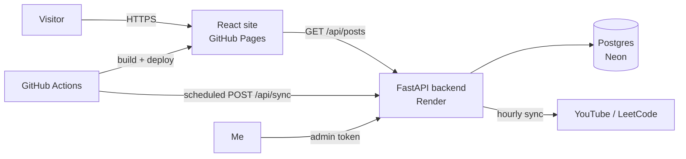

# Vensen Sibanda — Portfolio

### 🔗 Live site: **[ven-sib.github.io](https://ven-sib.github.io)**

A full-stack personal portfolio presenting my work in **cloud, backend, security, system design, AI agents and ML** — with a *Postings* section that updates itself with the videos I'm learning from, my LeetCode submissions, and my own notes.

[GitHub](https://github.com/Ven-Sib) · [LinkedIn](https://www.linkedin.com/in/vensen-sibanda-b2997b2a6) · sibandavensen@gmail.com

---

## What's on the site

| Page | What it shows |
|---|---|
| **Home** | Headline, photo, a floating **Spotlight** card rotating through featured projects, focus areas and the latest postings |
| **About** | How I work across the full lifecycle (customer → design → build → test → deploy → monitor), what I optimize for, skills by domain, coursework |
| **Experience** | Work history (Reserve Bank of Zimbabwe, ERISA Discovery) |
| **Projects** | Projects in priority order, filterable by domain, each linking to its live site or repo |
| **Leadership** | Programs and fellowships, each with a photo gallery |
| **Postings** | Videos, LeetCode, notes and articles, grouped by type with tag filters |
| **Admin** (hidden) | Owner-only panel for adding and deleting postings |

Every page has a **Back** button that returns to the page you came from.

> The animated visuals inside the Spotlight are **simulated illustrations**, labeled as such on the site. They are not real production data.

---

## Architecture



- **Frontend** is a static React app on **GitHub Pages**, built and deployed by GitHub Actions on every push.
- **Backend** is a **FastAPI** service on **Render** that stores postings in **Neon Postgres** and pulls LeetCode submissions on a schedule.
- **Sync**: a GitHub Actions job calls `/api/sync` every hour, which also wakes the free Render server if it is asleep.

### Tech stack

| Layer | Tools |
|---|---|
| Frontend | React 18, TypeScript, Vite, Tailwind CSS v4 |
| Backend | Python, FastAPI, SQLModel, httpx, Uvicorn |
| Database | Postgres on Neon (SQLite for local development) |
| CI/CD | GitHub Actions |
| Hosting | GitHub Pages (site), Render (API), Neon (database) — all free tiers |

---

## Project structure

```
.
├── .github/workflows/
│   ├── deploy.yml            # builds the frontend and publishes to GitHub Pages
│   └── sync.yml              # hourly call to /api/sync
├── backend/
│   ├── app/
│   │   ├── main.py           # routes, CORS, admin protection
│   │   ├── models.py         # Post model
│   │   ├── db.py             # database engine (SQLite or Postgres)
│   │   ├── sync.py           # YouTube + LeetCode sync
│   │   └── config.py         # settings from environment variables
│   ├── requirements.txt
│   └── .env.example
└── frontend/
    ├── public/
    │   ├── resume.pdf        # the Resume button opens this
    │   ├── me.jpg            # home page photo
    │   └── leadership/<role>/  # leadership photos
    └── src/
        ├── data/             # ← edit your content here
        │   ├── portfolio.ts  # profile, projects, experience, skills, about
        │   ├── spotlight.ts  # the floating Spotlight slides
        │   ├── leadership.ts # leadership roles + photo lists
        │   └── leadershipText.ts
        ├── components/       # pages and UI
        └── lib/              # API client, routing, hooks
```

---

## API

| Method | Path | Access | Purpose |
|---|---|---|---|
| GET | `/api/health` | public | Health check |
| GET | `/api/posts?kind=&limit=&offset=` | public | List postings (`kind`: `video`, `leetcode`, `text`, `link`) |
| POST | `/api/posts` | admin | Create a posting (YouTube links auto-fetch the title) |
| DELETE | `/api/posts/{id}` | admin | Delete a posting |
| POST | `/api/sync` | admin | Pull new YouTube / LeetCode items now |
| POST | `/api/admin/verify` | admin | Check an admin token (used by the lock screen) |

Interactive docs are available at `/docs` on the running backend.

---

## Security

- **Admin routes require a secret token** sent in the `X-Admin-Token` header. The token is compared in **constant time**.
- **Throttling:** after 8 wrong tokens from one address, further attempts get `429` for 10 minutes.
- **The admin page is not linked anywhere** and shows nothing but a lock screen until the *server* accepts the token. Hiding the page is a convenience; the real protection is on the server.
- **CORS** only allows the site's own origin (plus `localhost` for development).
- **Secrets live in environment variables** (Render and GitHub Actions secrets). `.env` files are git-ignored, and no secret is ever bundled into the frontend.
- Public endpoints are **read-only**.

Use a long random value for `ADMIN_TOKEN`:

```bash
python -c "import secrets; print(secrets.token_urlsafe(32))"
```

---

## Run it locally

You need **Python 3.10+** and **Node.js 20+**. Use two terminals.

### 1. Backend

```bash
cd backend
python3 -m venv .venv
source .venv/bin/activate          # Windows: .venv\Scripts\activate
pip install -r requirements.txt
cp .env.example .env               # Windows: copy .env.example .env
uvicorn app.main:app --reload --port 8000
```

Open `http://localhost:8000/docs`.

### 2. Frontend

```bash
cd frontend
npm install
npm run dev
```

Open `http://localhost:5173`. The admin page is at `http://localhost:5173/#/admin`.

### Environment variables

**`backend/.env`**

| Variable | Purpose | Default |
|---|---|---|
| `ADMIN_TOKEN` | Password for admin actions | `dev-token` (change it!) |
| `DATABASE_URL` | Database connection string | `sqlite:///./portfolio.db` |
| `FRONTEND_ORIGIN` | Allowed website address(es), comma separated | `http://localhost:5173` |
| `LEETCODE_USERNAME` | LeetCode profile to sync (must be public) | empty |
| `YOUTUBE_CHANNEL_ID` | Optional channel whose uploads are synced | empty |
| `SYNC_INTERVAL_MINUTES` | Background sync interval while the server is awake | `60` |

**`frontend/.env`**

| Variable | Purpose | Default |
|---|---|---|
| `VITE_API_URL` | Address of the backend | `http://localhost:8000` |

---

## Deploy

### 1. Database — Neon
Create a free Neon project and copy its connection string.

### 2. Backend — Render
Create a **Web Service** from this repo:

| Setting | Value |
|---|---|
| Root Directory | `backend` |
| Build Command | `pip install -r requirements.txt` |
| Start Command | `uvicorn app.main:app --host 0.0.0.0 --port $PORT` |
| Instance type | Free |

Environment variables: `DATABASE_URL` (Neon string), `ADMIN_TOKEN`, `FRONTEND_ORIGIN=https://ven-sib.github.io`, `LEETCODE_USERNAME`.

### 3. Frontend — GitHub Pages + Actions
In the repo go to **Settings → Pages → Source → GitHub Actions**, then **Settings → Secrets and variables → Actions**:

| Type | Name | Value |
|---|---|---|
| Variable | `API_URL` | Your Render URL, **no trailing slash** |
| Secret | `ADMIN_TOKEN` | Same token as on Render |

Push to `main` and the site builds and deploys automatically. If you change `API_URL` later, re-run **Deploy website to GitHub Pages** from the Actions tab.

---

## Updating content

| To change… | Edit |
|---|---|
| Bio, skills, projects, experience, GPA | `frontend/src/data/portfolio.ts` |
| Spotlight slides | `frontend/src/data/spotlight.ts` |
| Leadership roles and photo lists | `frontend/src/data/leadership.ts` |
| Home page photo | save a portrait as `frontend/public/me.jpg` |
| Leadership photos | put files in `frontend/public/leadership/<role>/` and list them in `leadership.ts` |
| Resume | replace `frontend/public/resume.pdf` |
| Postings (videos, notes, links) | the hidden admin page — no code needed |

Then publish:

```bash
git add .
git commit -m "Update content"
git push
```

---

## Notes and limits (free tiers)

- **Cold starts:** Render's free server sleeps after ~15 minutes without traffic and takes about a minute to wake. The Postings page shows a "server is waking up" message and keeps retrying; the rest of the site is static and loads instantly.
- **Hourly sync** runs from GitHub Actions. GitHub pauses scheduled workflows on a public repo after 60 days without repo activity — re-enable it from the Actions tab if syncing stops.
- **Schema changes:** the backend creates missing tables on startup but does not alter existing ones. A new column on `Post` needs a manual migration in Neon.
- **NeetCode** has no public API; solve problems on LeetCode and they sync automatically.

---

## Contact

**Vensen Siamaindi Sibanda** — B.S. Computer Science, Grambling State University (expected Dec 2027)

[ven-sib.github.io](https://ven-sib.github.io) · [GitHub](https://github.com/Ven-Sib) · [LinkedIn](https://www.linkedin.com/in/vensen-sibanda-b2997b2a6) · sibandavensen@gmail.com
